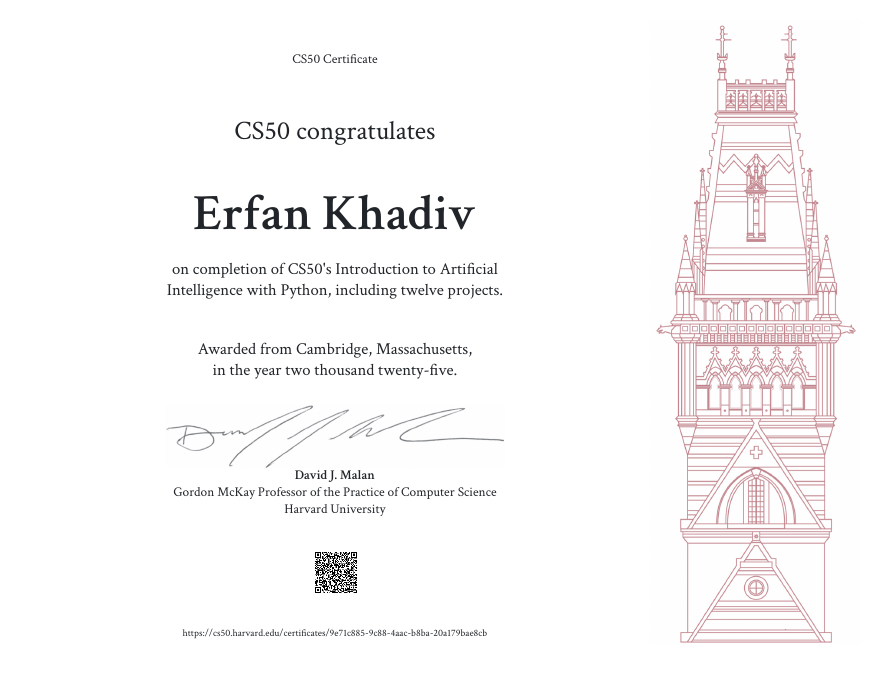

# CS50's Introduction to Artificial Intelligence with Python


Project work for [Harvard's CS50AI](https://cs50.harvard.edu/ai/) (taught by Brian Yu and David J. Malan), an introduction to the concepts and algorithms at the foundation of modern AI. The course moves from classical symbolic methods (search, logic, probabilistic reasoning, optimization) to machine learning, neural networks and transformer-based language models. I completed the course in 2025 and earned the [CS50 certificate](#certificate). This repository contains my implementations of eleven of its twelve projects, each one a self-contained program with its own README covering the idea, the implementation and how to run it.

## Contents

- [Certificate](#certificate)
- [Course map](#course-map)
- [Projects](#projects)
- [Concepts and skills covered](#concepts-and-skills-covered)
- [Repository structure](#repository-structure)
- [Setup and running](#setup-and-running)
- [Credits and license](#credits-and-license)

## Certificate

Awarded by Harvard's CS50 on completion of *CS50's Introduction to Artificial Intelligence with Python, including twelve projects* (2025), signed by David J. Malan.

[](certificate/CS50AI_certificate.pdf)

- Verify online: [cs50.harvard.edu/certificates/9e71c885-9c88-4aac-b8ba-20a179bae8cb](https://cs50.harvard.edu/certificates/9e71c885-9c88-4aac-b8ba-20a179bae8cb)
- PDF copy: [`certificate/CS50AI_certificate.pdf`](certificate/CS50AI_certificate.pdf)

## Course map

| Lecture | Topic | Project | Core technique |
| --- | --- | --- | --- |
| 0 | Search | [`degrees/`](degrees) | Breadth-first search on a graph |
| 0 | Search | [`tictactoe/`](tictactoe) | Minimax with alpha-beta pruning |
| 1 | Knowledge | [`minesweeper/`](minesweeper) | Propositional inference over constraint sentences |
| 2 | Uncertainty | [`pagerank/`](pagerank) | Markov chain sampling and iterative convergence |
| 2 | Uncertainty | [`heredity/`](heredity) | Bayesian network, inference by enumeration |
| 3 | Optimization | [`crossword/`](crossword) | Constraint satisfaction: node/arc consistency, backtracking |
| 4 | Learning | [`shopping/`](shopping) | Supervised learning: k-nearest neighbors |
| 4 | Learning | [`nim/`](nim) | Reinforcement learning: Q-learning |
| 5 | Neural networks | [`traffic/`](traffic) | Convolutional neural network |
| 6 | Language | [`parser/`](parser) | Context-free grammar and chart parsing |
| 6 | Language | [`attention/`](attention) | Self-attention analysis of BERT |

## Projects

### Search

**[Degrees](degrees)** finds the shortest chain of movies linking any two actors in an IMDb dataset ("Six Degrees of Kevin Bacon"). The actor/movie data is modelled as a graph, and `shortest_path` runs breadth-first search with a queue frontier and an explored set, which guarantees the minimum number of movies and returns `None` when the actors are not connected. The program handles ambiguous names by asking the user to pick between actors who share one.

**[Tic-Tac-Toe](tictactoe)** is an AI that plays optimally using minimax. X maximizes the board utility (+1 win, 0 draw, -1 loss) and O minimizes it. Alpha-beta pruning cuts off branches that cannot change the result, and ties between equally good moves are broken at random so games vary. The AI reports how many actions it explored on each move. It cannot be beaten, since the best a human can achieve is a draw.

### Knowledge

**[Minesweeper](minesweeper)** is an AI that plays Minesweeper using logical inference only. Each revealed number becomes a sentence of the form "exactly *n* of these cells are mines". The AI marks cells that a sentence proves safe or mined, propagates that to all other sentences, and derives new sentences from subset relations between them (`set2 - set1 = count2 - count1`). When no safe move can be proven, it falls back to a random move.

### Uncertainty

**[PageRank](pagerank)** ranks web pages with the random surfer model, computed two ways: by sampling 10,000 page visits from the transition model, and by iterating the PageRank formula until every rank changes by less than 0.001. The damping factor is 0.85. Pages with no outgoing links are treated as linking to every page. The two methods should agree closely, which serves as a sanity check.

**[Heredity](heredity)** computes the probability that each person in a family has 0, 1 or 2 copies of a gene, and whether they show a trait. A person's gene count depends on their parents' (each parent passes a copy with a probability that includes a small mutation chance), and the trait depends on the gene count. Exact inference by enumeration sums the joint probability over every consistent assignment, respecting known trait evidence, then normalizes.

### Optimization

**[Crossword](crossword)** generates a crossword by treating each slot as a variable whose domain is a set of words. The solver enforces node consistency (word length matches slot length) and arc consistency with AC-3 (overlapping slots must agree on shared letters), then runs backtracking search. It picks the next variable with the minimum-remaining-values heuristic, breaking ties by highest degree, and orders values by how few options they rule out for neighbouring variables. A second variant interleaves AC-3 inference with the search.

### Learning

**[Shopping](shopping)** predicts whether an online shopper will complete a purchase from browsing-session features such as page counts, durations, bounce rates, month and visitor type. After loading and encoding the data, it trains a k-nearest neighbors classifier (k = 1) on a 60/40 train/test split and evaluates it with sensitivity (true positive rate) and specificity (true negative rate), which matter here because most sessions do not end in a purchase.

**[Nim](nim)** is a reinforcement learning agent that learns the game of Nim by playing itself. It uses Q-learning with learning rate α = 0.5 and an ε-greedy policy with ε = 0.1: it updates `Q(s, a)` towards the observed reward plus the best estimated future reward, and mostly picks the highest-valued action while sometimes exploring. After training on self-play games, the agent plays against a human with exploration turned off.

### Neural networks

**[Traffic](traffic)** classifies German traffic sign images (GTSRB, 43 categories) with a convolutional neural network built in TensorFlow/Keras. Images are resized to 30×30×3, and the network stacks two convolution + max-pooling blocks (32 and 64 filters of size 3×3), a 128-unit dense layer, 0.5 dropout and a 43-way softmax output, trained with Adam for 10 epochs on a 60/40 split. The project README records the architectural experiments (layer counts, filter sizes, dropout rate, optimizers) and the reasoning behind the final choice.

### Language

**[Parser](parser)** parses English sentences with a hand-written context-free grammar and NLTK's chart parser. The grammar covers sentences, noun phrases, verb phrases, prepositional phrases, adjective phrases and conjunctions. After parsing, the program extracts noun phrase chunks: NP subtrees that contain no other noun phrase inside them.

**[Attention](attention)** visualizes the self-attention heads of BERT (`bert-base-uncased`) on a masked sentence. The program predicts the top 3 words for the `[MASK]` token, then generates one grayscale diagram per head (12 layers × 12 heads), where lighter cells mean stronger attention between two tokens. [`analysis.md`](attention/analysis.md) interprets what two of the heads appear to be doing, with the matching diagrams in [`attention/diagrams/`](attention/diagrams).

## Concepts and skills covered

- **Search:** BFS, adversarial search, game trees, pruning
- **Knowledge representation:** propositional logic, constraint sentences, inference by subset reasoning
- **Probabilistic reasoning:** Markov chains, Bayesian networks, joint and conditional probability, enumeration
- **Optimization:** constraint satisfaction, arc consistency (AC-3), backtracking with heuristics
- **Machine learning:** supervised classification, train/test evaluation, sensitivity and specificity, Q-learning
- **Deep learning:** convolutional networks, regularization with dropout, image preprocessing
- **Natural language processing:** context-free grammars, chart parsing, transformer attention analysis
- **Tools:** Python, NumPy, scikit-learn, TensorFlow/Keras, OpenCV, NLTK, Hugging Face Transformers, pygame

## Repository structure

```
CS50AI/
├── degrees/        # BFS shortest path (small dataset included)
├── tictactoe/      # minimax + alpha-beta pruning
├── minesweeper/    # logical-inference agent
├── pagerank/       # sampling + iterative PageRank, 3 test corpora
├── heredity/       # Bayesian network over 3 sample families
├── crossword/      # CSP solver
├── shopping/       # k-NN classifier
├── nim/            # Q-learning agent
├── traffic/        # CNN for GTSRB
├── parser/         # CFG parser and NP chunker
├── attention/      # BERT attention diagrams and analysis
├── certificate/    # CS50AI certificate (PDF and preview)
├── LICENSE
└── README.md
```

## Setup and running

Each project is self-contained. Python 3.9+ is recommended. Install the dependencies for the project you want to run:

| Project | Dependencies |
| --- | --- |
| `degrees`, `pagerank`, `heredity`, `crossword`, `nim` | Python standard library (`crossword` image output needs Pillow) |
| `tictactoe`, `minesweeper` | `pygame` |
| `shopping` | `scikit-learn` |
| `traffic` | `tensorflow`, `opencv-python`, `scikit-learn` |
| `parser` | `nltk` |
| `attention` | `tensorflow`, `transformers`, `pillow` |

```
cd <project-folder>
pip install -r requirements.txt   # if present
python <script>.py [args]
```

Quick examples:

```
python degrees/degrees.py degrees/small
python pagerank/pagerank.py pagerank/corpus0
python heredity/heredity.py heredity/data/family0.csv
python tictactoe/runner.py
```

See each project's own README for exact arguments, datasets and example output.

## Credits and license

Course materials and problem specifications are by the [CS50AI](https://cs50.harvard.edu/ai/) staff at Harvard. Released under the MIT license; see [LICENSE](LICENSE).

The course provided starter code for each project, including the `Crossword` and `Variable` data structures in `crossword.py`, the `runner.py` interfaces for `tictactoe` and `minesweeper`, `util.py` and the data loading in `degrees`, the `Minesweeper` game class, the probability tables and scaffolding in `heredity`, `crawl` in `pagerank`, and `generate_diagram` in `attention`. The solving and learning logic is my own coursework: `shortest_path` (`degrees`), the game model and `minimax` (`tictactoe`), `Sentence` and `MinesweeperAI` (`minesweeper`), `transition_model`, `sample_pagerank` and `iterate_pagerank` (`pagerank`), `joint_probability`, `update` and `normalize` (`heredity`), the CSP solver in `generate.py` (`crossword`), model training in `shopping.py`, Q-learning in `nim.py`, the grammar and chunking in `parser.py`, the CNN architecture in `traffic.py`, and the helper functions and analysis in `attention`.
